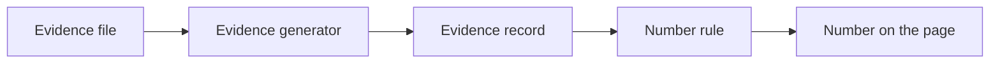

# Diego Souza, AI Engineer: portfolio

<!-- case:start -->
## The case

- **Problem.** A portfolio makes claims. Without a rule that ties each number to a saved run, it drifts toward marketing.
- **Decision.** A prerendered React site where every number is an evidence record copied from a project repository at an exact commit. A test fails on a digit in case text that has no record. Diagrams are laid out by ELK at build time and drawn as SVG by React; no layout engine reaches the browser.
- **Measured.** Real Chrome with axe and contrast passes on all 28 routes (14 pages in each language) at 1000 and 360 px. The worst route loads 95.1 KB gzip of JavaScript against a 100 KB budget. Source: `artifacts/evidence/portfolio-w7/check-full.txt`.
- **Run it.** `npm ci && python scripts/check_fast.py` (then `python scripts/check_full.py` with Chrome installed).
- **Limits.** Not published yet. The 3D scene (`SCENE-*`) is not built, frame rate on a phone is not measured, and the live demo has not run against a deployed stack.
- **Docs.** [Architecture](docs/architecture.md), [phase 003](.planning/phases/003-real-portfolio/SPEC.md).
<!-- case:end -->

<!-- flow:start -->
## How it works

Generated from the same data as the diagram on the portfolio site (`projects/design-system/`), so the two cannot drift.


<!-- flow:end -->

Static React site for [Diego Vieira Gonçalves de Souza](https://www.linkedin.com/in/diegovsouza99), AI Engineer. The English CV text in `src/content/profile.ts` is a draft until the owner reviews it; the CV file itself and the phone number are never in Git.

## Develop

```powershell
npm ci
npm run dev                      # Vite dev server (client only)
npm run evidence:gen             # copy values from the sibling repositories into src/data/evidence.generated.json
npm run flow:gen                 # lay out the flows with ELK and pin the sibling commits
python scripts/check_fast.py     # lint, types, catalog, evidence and flow checks, unit tests
python scripts/check_full.py     # plus build, per-route budget, Playwright + axe in Chrome
```

## How it is built

- `vite build` makes the client, `vite build --ssr` makes the server bundle, and `scripts/prerender.mjs` writes every route to `dist/<path>/index.html` with its own title, description, Open Graph tags, hreflang links and a modulepreload for the chunks that route needs.
- `src/content/cases/*.ts` is case text (EN and pt-BR). A digit that states a result must come through an `{ev:id}` token. `src/content/profile.ts` holds the CV, labelled as career history.
- `functions/api/*` are Cloudflare Pages Functions: `status` (reads Fly with a read-only token, wakes nothing), `demo/start` (Turnstile, kill switch, per-visitor limit, then wakes in dependency order) and `runs/latest` (recorded runs, no visitor text). Tested with mocks; not deployed.
- `elkjs` is a build-time dev dependency (EPL-2.0 OR GPL-3.0). It is imported only by `scripts/flows.mjs`, never by anything under `src/`.

Design: `DESIGN_SYSTEM_COLAGEM_URBANA_NOITE.md`, tema Breu, from the vendored `colagem-ui` tarball (pinned in `docs/harness/sources.lock.json`).
