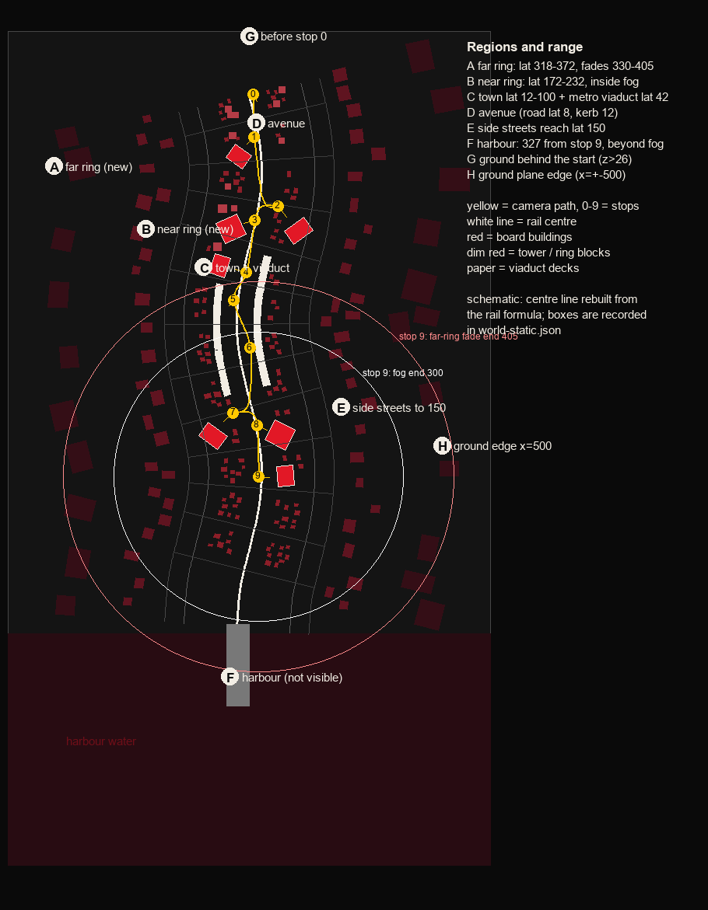
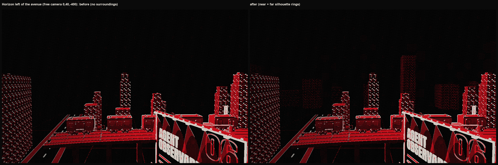
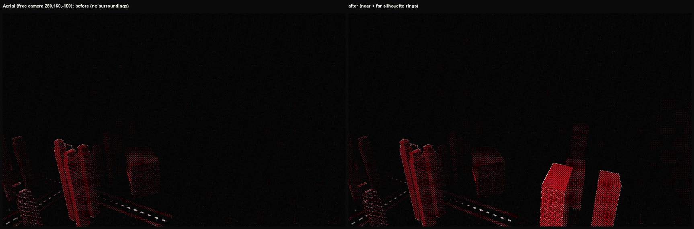

# Plano do entorno da cidade (fase 016)

Status: **proposta técnica + primeira camada implementada**. Nada aqui foi aprovado artisticamente: a aprovação é do dono. Números vêm de execuções reais desta fase (`artifacts/evidence/world-direction-016/`); o que não foi medido está marcado.

## 1. O que existe hoje (medido)

| Fato | Valor | Origem |
|---|---|---|
| Neblina | começa em 70, termina em 300 | `scene.ts` |
| Câmera | near 0,5, far 420 | `scene.ts`, `world-static.json` |
| Draw calls no primeiro frame | **80** antes do cenário, **82** com os dois anéis (limite 100) | `data-draws`, medido em dev |
| Chão | plano de 1000 de largura, de z=160 até z=-1091 | `world-static.json` |
| Porto | água de z=-1091 a -1571; cais, guindastes, farol, navio | `world.ts` |
| Distância do último stop (9) até a orla | **327** unidades, maior que o fim da neblina (300) | `world-static.json` |
| Cidade (torres) | lateral até ~100 da avenida; ruas laterais vão até 150 | `world.ts` (`lane`, `CROSS_REACH`) |
| Fundo | cor chapada `ink`; tudo além de ~300 vira preto | capturas `views-2/` |

Leitura das capturas livres (`views-2/`, antes do cenário): além da neblina não há linha de horizonte nem silhueta distante; vista lateral e aérea terminam em preto; o porto não aparece de nenhum stop (fica além do fim da neblina). A margem oposta do porto ficaria a 670 unidades ou mais de qualquer câmera, portanto **não foi desenhada**.

Mapa por região: 

## 2. Linguagem visual a respeitar

- Paleta: `ink` (fundo), `paper`, `red`, `dred`, `ink-2`; todo cinza é mistura de ink e paper (`tokens.ts`). Nenhuma cor literal.
- A tela passa por meio-tom (halftone): nas capturas, silhuetas de contraste baixo quase somem. O limiar de contraste mínimo não foi medido.
- Editorial / low-poly: caixas com recuo e coroa, janelas emissivas esparsas, sem textura nem detalhe fino.
- Cada stop é um enquadramento: o card cobre ~60% da tela; o entorno aparece nas margens, no alto e entre os stops. Por isso o horizonte pesa mais **entre** os stops e nos stops de telhado (3 e 8) e de meio-fio (4 e 9).

## 3. Plano por região

| Id | Região | Onde (coordenadas / lateral à avenida) | Relação com paradas e câmera | 1º plano | Plano médio | Fundo | Estado |
|---|---|---|---|---|---|---|---|
| D | Avenida e calçadas | lat 0–12 | todas as paradas | faixas, carros, postes | — | — | existe |
| C | Cidade e corredor do metrô | lat 12–100; viaduto em ±42 | paradas 1–8 | placas, prédios das placas | torres, viaduto, trens | — | existe; corrigido nesta fase |
| E | Ruas laterais | até lat 150 | paradas laterais 2 e 7 | pista, calçada | torres das quadras | — | existe |
| B | **Anel próximo** | lat 172–232; z de 0 à orla | visto sobre os telhados e entre as ruas | — | silhuetas escuras dentro da neblina | — | **implementado** (`horizon.ts`) |
| A | **Anel distante** | lat 318–372; z de 0 à orla | visto no alto da tela, entre paradas | — | — | silhuetas com fade próprio até o far plane | **implementado** |
| F | Porto e cais | z < -1091 | fim da avenida, parada 9 | — | — | invisível: além da neblina | **decisão do dono** (D2) |
| G | Antes do stop 0 | z > 26, grade até z=160 | nunca visível pela câmera do percurso | — | — | — | sem ação |
| H | Borda lateral do chão | x = ±500 | nunca visível (neblina) | — | — | — | sem ação |
| S | Céu | acima do horizonte | todas as paradas | — | — | cor chapada `ink` | **decisão do dono** (D3) |

Percurso: a câmera sobe até 30 de altura nos stops de telhado (3 e 8). Ali o anel próximo (altura 26–92) cruza a linha do olho e é o que mais muda a composição; nos stops de meio-fio (altura 1,7) o anel só aparece sobre os telhados.

## 4. Modelos, origem, licença e orçamento

Fase 1 (feita): **sem ativo novo**. Silhuetas são caixas procedurais geradas por `src/scene/horizon.ts`, coloridas por tokens. Não entra nada em `assets/`, então o ledger e `node tools/assets.mjs audit` ficam como estavam (`audit: OK (15 arquivos)`).

| Item | Triângulos | Draw calls | Origem / licença |
|---|---:|---:|---|
| Anel próximo (53 caixas, uma malha) | 636 | +1 | procedural, sem licença |
| Anel distante (22 caixas, uma malha) | 264 | +1 | procedural |
| **Total fase 1** | **900** | **+2 (80 → 82)** | |

Fases seguintes (propostas, ainda não feitas):

| Item | Origem possível | Licença | Orçamento |
|---|---|---|---|
| Torres do anel próximo trocadas por `building-medium` e `building-small` instanciados e escurecidos | já no repositório (Quaternius, Downtown City MegaKit) | CC0 | 1.698 e 1.260 triângulos por instância: com ≈ 60 instâncias seriam ≈ 90 mil; **só com LOD** (caixa abaixo de 150 unidades) |
| Guindastes e navio do porto como peças reais | pacotes locais ainda não usados; verificar licença de cada um | CC0, ou CC-BY só com autorização e crédito | ≤ 1.500 triângulos por peça; +2 draw calls |
| Qualquer modelo novo | só por `node tools/assets.mjs`, com ledger | CC0 | ≤ 8.000 triângulos por modelo, sem textura, sem cor literal |

Limite de draw calls: o primeiro frame tem 82 de 100. Reserva para as próximas fases: **até +12**, sem passar de 94.

Carregamento e plano B: a fase 1 não carrega nada de rede nem de arquivo (geração no `buildWorld`). Uma constante `SURROUNDINGS` em `src/scene/layout.ts` liga e desliga tudo: `false` devolve a cidade como estava. Modelos reais das fases seguintes carregariam depois do primeiro frame (como carros e trens, via `onModels`) e, se falharem, as caixas procedurais continuam.

## 5. Capturas comparativas

- Horizonte à esquerda: 
- Vista aérea: 

Leitura do agente (não é aprovação): à esquerda da avenida, atrás do viaduto, surgem camadas de silhuetas de dois tons que dão profundidade; na vista aérea o anel aparece de forma muito sutil no canto direito. **O contraste é baixo por escolha conservadora**, e o meio-tom come parte dele. Se o dono quiser o horizonte mais presente, as alternativas estão em D1.

## 6. Etapas, critérios e riscos

| Etapa | O que | Critério técnico | Critério visual (agente) | Aprovação humana |
|---|---|---|---|---|
| S1 (feita) | anéis procedurais | testes unitários passam; draw calls ≤ 100; sem sobreposição com a cidade (`COLLISIONS.md`) | camadas legíveis atrás do viaduto | pendente |
| S2 | ajuste de contraste e altura (D1) | mesmos | silhueta visível nos stops 3 e 8 sem competir com o card | **necessária** |
| S3 | decisão do porto (D2) | porto visível de pelo menos um stop ou removido do orçamento | farol ou cais legível no stop 9 | **necessária** |
| S4 | decisão da estação (D4) | nenhuma sobreposição trem × estação | trem entra na estação de forma plausível | **necessária** |
| S5 | faixa de céu (D3) | sem custo de draw call acima de +1 | horizonte tem uma linha, não um vazio | **necessária** |
| S6 | peças reais no anel próximo | ≤ 8.000 triângulos por modelo, ledger e `audit` verdes | coerência de estilo | **necessária** |

Riscos: (1) o meio-tom pode apagar silhuetas de contraste baixo; (2) ruas laterais mais longas ou novas torres reabririam o conflito com o anel; o teste `horizon.test.ts` guarda a distância de 150; (3) mais draw calls em celulares: a fase 1 usa +2; (4) custo de GPU: a correção do laço duplicado (commit `d8161a5`) reduziu os desenhos por segundo de 202 para 100,2 (`loop-rate.txt`); o efeito em tempo de GPU não foi medido.

## 7. Decisões para o dono

**D1. Quanto contraste tem o horizonte** (anel distante hoje entre `ink` e `dred` a 16–26%).
A) manter (sutil). B) subir para 30–40% (silhueta clara, ainda abaixo da cidade). C) contorno `paper` fino no topo dos blocos (leitura gráfica, mais editorial).

**D2. O porto.** Hoje invisível de qualquer parada (327 > 300).
A) deixar. B) alongar a neblina só nos dois últimos stops (fim em 380). C) aproximar o porto 150 unidades (muda o fim da avenida e `ROAD_EXTRA`).

**D3. O céu.** Hoje `ink` chapado.
A) manter. B) faixa de brilho vermelho baixo no horizonte (+1 draw call). C) degradê `ink` → `ink-2` acima do horizonte.

**D4. A estação de metrô.** Escala do modelo 1,15 contra trens de escala 5,2: cada trem tem 7,0 de largura e a estação inteira 9,0, então os trens passam por dentro dela (**confirmado em malha** com o Blender MCP, `artifacts/evidence/world-direction-016/blender-station.json`: 2.938 triângulos da estação contra os três modelos de vagão, vagão deslizado por 401 posições; faixa -3,7 sem interseção, faixa +3,7 com interseção em 83 posições e 635 a 792 pares de triângulos. A estação invade uma das duas vias; deslocá-la lateralmente não resolve, porque o vagão tem 7,0 de largura num convés de 14).
A) remover a estação. B) escalar a estação para o tamanho dos trens (cerca de 5×: 125 de comprimento, 22 de largura; domina o stop 5). C) trocar por uma plataforma procedural baixa ao lado dos trilhos (sem licença CC-BY, sem crédito no rodapé).

## 8. Limites desta análise

- Capturas realmente lidas estão listadas em `artifacts/evidence/world-direction-016/FINDINGS.md`; não li todos os stops nem todos os quadros de voo.
- Dispositivo real, desempenho em celular e a opinião do dono não foram verificados.
- O mapa é esquemático: a linha central da avenida foi reconstruída pela fórmula do trilho.
